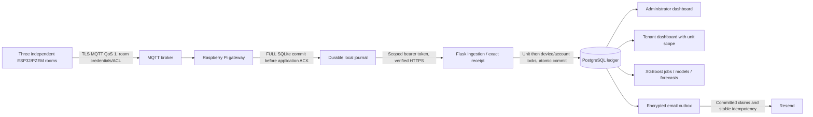

# DormEnergy software stabilization audit

Audit date: 12 October 2026. Review branch: `feature/software-stabilization`, based on `feature/raspberry-pi-gateway` at `4c7dc68a6fbd1c4601f143e2f6682f7569b89502`. Production `main` remains `24f6ecf4ff565d7f9ea538c163a5ae8a47d62152`. Gateway package: **0.1.1**. The [baseline](software-audit-baseline.md) was recorded before product edits. No main merge, Render deployment, live emails, account changes, tariff confirmation or secret rotation was performed.

## Architecture and scope

In tests the ESP32 rooms are explicitly marked mock publishers and all destinations/databases are disposable loopback fixtures. This is evidence of the software chain, not physical meters, mains control or field reliability. `main` does not have the gateway receipt endpoint; first uploads can succeed there but ambiguous conflicts remain held. The combined reviewed backend/gateway version is required before a real installation.

Review covered every application/service module, templates and dashboard scripts, models/versioned migrations, gateway package and broker/systemd templates, startup scripts, dependency pins, CI and existing guides. The schema remains **d21ae48f397c**, with 17 tables; there is no new PostgreSQL migration. The local SQLite journal gains an additive partial index without rewriting or deleting measurements. Financial arithmetic, tariffs, identities and retained records are preserved.

## Findings and completed fixes

| Finding | Evidence and consequence | Completed change |
| --- | --- | --- |
| High: device revocation while an authenticated request waits for a unit lock | An actual PostgreSQL interleaving returned 201 with the now revoked token. | Pass the authenticated hash snapshot and compare it against the freshly locked device before any reading/charge write. Regression now returns 401 and leaves the balance unchanged. |
| High: ended tenant submitting credit while waiting for the unit lock | Actual PostgreSQL race admitted a credit request after tenancy termination. | Reload/lock the tenant after the unit lock; recheck activation, tenancy, password-change requirement and session version. Regression returns 403 with no credit request. |
| Medium: excess precision silently rounded by the database | Submitted counters could differ from stored receipts; voltage/current/power also admitted unsupported precision. Boolean `true` could equal unit ID 1. | Strict integer and exact Decimal precision checks before writes. Legacy isolated simulator rounds its generated values at the producer to the same declared schema precision. No simulator starts in production. |
| Medium: future sample displayed as current; timezone underflow escaped validation | A permitted small future clock skew produced an online/current dashboard value; extreme ISO timestamps raised overflow. | Freshness requires nonnegative age; timestamp normalization catches overflow in backend and gateway. |
| Medium: transient database connection failure lacked an intentional retry response | Stale pooled connections and driver errors were not consistently classified. | Pool pre-ping/recycle, SQL parameter hiding and a sanitized 503 handler with rollback/removal. Scoped fault injection verifies recovery and absence of a secret sentinel in response/logs. |
| Medium: truncated/deep/invalid provider replies could fail the worker or falsely acknowledge mail | HTTP body exceptions and missing/empty provider IDs were not adequately validated. | Bounded JSON decoding, HTTP exception handling, strict provider message IDs and stable transient retries. No live provider request was used. |
| Medium: gateway malformed acceptance or partial response | Boolean receipt identity could compare equal to an integer; partial HTTP body raised a worker exception. | Strict integer receipt/positive acceptance ID, bounded/deep JSON checks and retryable HTTP body failures. Payloads remain durable. |
| Integration: backend identifiers up to 80 characters versus gateway limit 64 | A legitimately registered meter could not be provisioned into the gateway. | Match the 80-character backend identifier contract; reject CR/LF/NUL in header identifiers. Alias/event/epoch limits remain bounded. |
| Performance: queue head and neighboring-counter searches scanned/sorted entire histories | Baseline 5,000-row median claim 14.439 ms; enqueue 0.687 ms. | Seek one indexed oldest unsent head per room, and bounded predecessor/successor queries in queue/receipts. Measured claim 0.027 ms; enqueue 0.108 ms. Per-device order, blocked-head isolation and permanent dedupe proofs remain intact. |
| Performance: per-unit dashboard queries | Baseline snapshot used 17–19 SQL statements for three rooms. | Batch device/account/tenant/latest-reading lookups; use the existing PostgreSQL device/time index. Now 11 statements. No speculative cache or extra infrastructure. |
| Forecast validation: only next-hour evaluation, no model-age policy | Existing 24-hour issuance had no recursive evaluation. | Add fixed-model rolling held-out 1/6/12/24-hour endpoint/cumulative metrics with persistence/seasonal baselines, complete-origin checks and no future actual input. Preserve old reports; add due/expired policy and UI summaries. |
| Forecast correctness: NaN could become zero during nonnegative clipping | Python `max(0, NaN)` can return zero, bypassing the later finite check. | Validate raw estimate finiteness before clipping; NaN and either infinity now reject issuance. Set DMatrix construction to one XGBoost thread as well as model training/inference. |
| Dependency advisories in six pinned packages | Read-only PyPI release metadata identified affected Flask, pytest, dotenv, cryptography and gateway build tools. | Update runtime/direct/lock/build pins consistently; install and build verified artifacts. Final 35-package active-platform advisory check returned zero advisory-listed versions and zero unavailable checks. This is not a claim that no undisclosed vulnerability exists. |
| Logging after migration | Alembic's default fileConfig disables loggers already created in a shared process. | Preserve existing loggers using `disable_existing_loggers=False`; remove the network test workaround. |

Baseline regression runs passed 87 backend and 59 gateway tests. New race/precision tests reproduced real failures before the fixes. The initial precision test also had a timestamp fixture mistake, and the first recursive test incorrectly treated a new origin as a continuation; these test defects were corrected separately. Strict precision exposed a real legacy simulator regression, which was fixed at its fixture producer. Initial forecast browser code used the wrong selector; the helper was corrected to `unit-filter`, without changing CSP or application behavior. Final outcomes are documented in [software-validation.md](software-validation.md).

## Dashboard and financial integrity review

The existing owner setup, secure login/logout, profile/password/session revocation, tenant invitation/activation/reset/turnover, unit register/edit/archive/restore, manual credit review, rate validity, device provisioning, history/export, notifications and forecast workflows remain available. Tenant state is always resolved by backend role/unit checks; altered `unit_id`, archive/demo flags and administrator POSTs are rejected. Current tenant credit lists and exports exclude prior tenancies; consumption is unit history, and remaining credit belongs to the unit. These policies are documented rather than silently changing balances on turnover.

Cumulative-energy deltas, zero-cost first/reset baselines, six-decimal PHP deductions, two-decimal top-ups, effective-date interval prorating, ordered replay, atomic rollback and the unique reading-to-consumption-transaction relation remain authoritative. Tests cover concurrent meter duplicates, credit approvals, archive/credit/reading races, expired/gapped rates and rollback. In the network run, 174 accepted readings produced 171 unique charges (three baseline readings), and each balance matched its ledger exactly. Invalid/tariff-blocked events caused no partial financial writes. No Meralco price or legal approval was created: the owner-supplied PHP14.74 reference remains unverified and cannot activate charges without applicable source/period confirmation.

## Security assessment

| OWASP-oriented area | Verified protection / evidence | Remaining operational limit |
| --- | --- | --- |
| Injection and output handling | SQLAlchemy-bound inputs; modified SQL-like IDs rejected; Jinja escaping and dashboard escaping/textContent; CSV formula guard. | No comprehensive external penetration test or automated coverage percentage is claimed. |
| CSRF and sessions | Cookie-authenticated writes require CSRF; real HTTPS browser checks include secure cookies, strict origin checks, expired-form recovery and password/session revocation. | Keep one stable strong signing key across workers; trusted proxy configuration must be reviewed before trusting forwarded IPs. |
| Access control / IDOR | Tenant foreign-unit snapshot/forecast/export and 12 administrator write endpoints rejected; credentials rechecked after lock races. | One current tenant per unit; administrator role is trusted for dormitory operations. |
| Authentication and links | Scrypt password/device hashes; owner setup secret; password length validation; login failure limits; scoped, hashed, expiring, single-use account links. | No MFA; account-based login limits are not a distributed abuse-prevention service. Device tokens have revocation/rotation, **no time-based expiry**. |
| IoT replay and identity | Authenticated broker ACLs, exact topic/unit/device matching, durable canonical dedupe, timestamp/epoch checks and exact scoped 409 receipts. | Meter reset approval and original counter/time correctness ultimately depend on reviewed firmware/operator procedures. |
| Secrets and transport | Files protected; headers/redirects bounded; gateway TLS verification; encrypted email payloads; fixed safe errors/logs and SQL parameter hiding. | Encrypt and restrict host/database backups; SQLite holds private reading payloads without disk encryption; shared broker credential loss is an operational risk. |
| Resource handling | Body caps, depth/precision/finite/range validation, queue admission/backpressure, finite retries and scoped database fault recovery. | No absolute wall-clock deadline against a server continuously trickling response bytes; socket deadlines and supervisor shutdown bound routine faults. Receipt proofs grow indefinitely and require storage monitoring. |
| Dependencies | Six affected pins patched, exact active-platform release advisory checks and pip dependency integrity/build successful. | PyPI metadata is a limited advisory feed; OS/broker packages, supply-chain hashes and unknown issues require ongoing review. |

No intrusive test was directed at Render. No real account token, email key, password, connection secret or `.env` content is committed to the evidence. Provider acceptance is separated from inbox delivery. In-flight mail cannot be recalled; account-link invalidation and recipient snapshots protect reassignment, with documented limits.

## Performance and resources

Same script, same three-room/9,999-reading PostgreSQL fixture and 5,000-row SQLite queue:

| Measure | Before | After |
| --- | --- | --- |
| Dashboard SQL statements | 17–19 | 11 |
| Dashboard median / p95 | 14.004 / 16.045 ms | 12.499 / 25.017 ms |
| Authorized ingestion median / p95, 60 events | 89.764 / 106.303 ms | 83.269 / 88.215 ms |
| Queue enqueue median / p95 | 0.687 / 1.762 ms | 0.108 / 0.169 ms |
| Queue claim median / p95, 100 claims | 14.439 / 24.926 ms | 0.027 / 0.034 ms |
| Script CPU / peak RSS | 12.015 s / 129.691 MiB | 6.808 s / 130.270 MiB |

Dashboard p95 increased in this short after-run; concurrent test activity/host scheduling can affect timing. Query counts and the queue algorithm improvement are reproducible evidence; no latency SLA or statistically significant general speed claim follows from one run. Authenticated API timing includes intentionally expensive token hash validation. PostgreSQL EXPLAIN shows the existing `reading_time_unique` index scan; an additional PostgreSQL index was not justified.

A 20,000-row backlog had median enqueue 0.286 ms and claim 0.038 ms, retaining 19,900 unsent rows after 100 local claims. The verified HTTPS network run recorded a 60.128-second cloud outage, 174/174 deliveries, zero duplicate charges, zero final unresolved events, and successful forced-process-kill recovery. Full JSON and exact measurement boundaries are in [committed evidence](audit-evidence/) and [validation](software-validation.md). No 24/7 endurance or physical power-loss durability is claimed.

## Changed files and release contents

| Files / groups | Purpose |
| --- | --- |
| `dormenergy/__init__.py`, `migrations/env.py` | Safe database recovery, model-age config and logger preservation; schema unchanged. |
| `dormenergy/api.py`, `hardware.py`, `services/billing.py` | Lock-time authorization, exact measurements, source/role scopes and batched snapshots. |
| `dormenergy/email_links.py`, `services/emailing.py` | Deep JSON, provider reply validation and retry classification. |
| `dormenergy/services/forecasting.py`, `static/js/dashboard.js` | Shared recursive inference, multi-horizon evaluation, nonfinite rejection, model-age status and existing-card summaries. |
| `dormenergy/services/simulation.py` | Preserve the explicitly isolated legacy fixture producer under stricter precision. |
| `gateway/src/dormenergy_gateway/{queue,cloud,config,validation,__init__}.py`, `gateway/pyproject.toml` | Indexed queue seeks, response/identity/time handling, safe identifiers and package 0.1.1. |
| `requirements.txt`, `requirements.lock.txt`, `gateway/requirements-dev.txt` | Verified patched runtime and build pins; production web requirements do not add MQTT dependencies. |
| `tests/test_stabilization.py`, forecast/email tests, gateway unit/E2E tests | Meaningful security/race/numeric/provider/recovery regressions and controlled network stress. |
| `scripts/audit_benchmark.py`, `audit_release_check.py`, `audit_browser_workflows.py`, `browser_forecast_smoke.py`, `check_dependency_advisories.py` | Reproducible disposable measurement, startup/backup, browser and advisory checks. |
| `.github/workflows/build.yml` | PostgreSQL tests/schema, advisory evidence, portable Linux/Windows matrices and MQTT network checks. |
| `.env.example`, README, API/forecast/deployment/testing/gateway guides, audit/release documents and small JSON evidence | Configuration, methodology, results, limits, procedures and review materials. |

The branch contains the original gateway integration as well as stabilization. Compare against the gateway base to review the new audit changes separately; compare against main to review the entire integration. No history rewrite, deployment, main merge or database downgrade is required for review.

## Engineering assessment

Scores reflect implemented software and executed local evidence, not visual appearance, physical accuracy or hosted availability.

| Component | Score /10 | Justification and remaining limit |
| --- | --- | --- |
| Flask backend | 8.5 | Scoped endpoints, recovery and real lock-race regressions pass; public hosted capacity remains unverified. |
| Administrator dashboard | 8 | Existing workflows, role enforcement and browser layouts validated; external payment verification stays manual. |
| Tenant dashboard | 8 | Foreign-unit and administrator operations rejected; account/credit/export scopes tested; one-tenant policy limits scope. |
| PostgreSQL | 8.5 | Versioned schema, unique constraints, atomic locks and disposable backup/restore pass; live managed recovery/retention untested. |
| Prepaid billing | 8.5 | Decimal precision, ordered replay, duplicate/concurrency/validity rollback pass; interval allocation and settlement policy need research review. |
| XGBoost forecasting | 7 | Source/coverage/leakage/recursive/staleness checks and baselines implemented; synthetic occupancy-change fixture underperforms baselines, with no real-data accuracy study. |
| Email system | 8 | Encrypted transactional outbox, single-use links, retries/leases/quotas/session recovery tested; no real provider/inbox or webhook evidence. |
| Raspberry Pi gateway software | 8.5 | Actual MQTT/TLS/HTTPS chain, storage limits, exact receipts, forced kill and recovery; Pi ARM/SD/firmware and field trials untested. |
| Security | 8 | Verified scopes/TLS/CSRF/output controls, two authorization races fixed, affected pins patched; MFA/device TTL/full pentest absent. |
| Testing and reliability | 8 | Broad backend, gateway, browser, failure/stress/backup evidence; limited minutes of endurance and no external platform/CI execution. |
| Deployment readiness | 6.5 | Local real-mode startup/supervision/schema pass; hosted memory, always-on plan, verified tariff/sender, cloud backups and hardware are still prerequisites. |

**Overall software-only assessment: 8.0/10** (rounded equal-weight component mean). Ready for review and a controlled isolated/staging integration trial after configuration and required checks. It is not certified for unattended occupied-building billing or 24/7 operation. See [release-readiness.md](release-readiness.md) for concrete gates and rollback.
