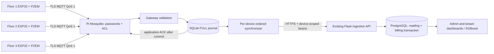

# Architecture and file map



MQTT suits three independent Wi-Fi rooms because messages are small, QoS 1 reconnects and broker sessions are established, and credential-specific ACLs scale to further rooms. It does not fix Wi-Fi coverage: survey each floor, prefer Pi Ethernet, and add managed access points as required. An ESP32 sees only its own telemetry/status write topics and ACK read topic. The subscriber cannot inspect a publisher's MQTT username; authenticated TLS broker ACLs establish that boundary, followed by exact topic/device/unit validation. Topic naming alone is not authentication.

`use_username_as_clientid true` binds persistent broker sessions to authenticated usernames. Use one publisher per room identity, unique credentials and no wildcard grants. The gateway username can read room telemetry/status and write ACKs; it cannot publish measurements. No MQTT listener should be accessible from the Internet. HTTPS uses normal system CA verification, optionally an explicitly trusted private CA, and rejects redirects to avoid forwarding device bearer credentials.

## Data and failure behavior

A validated frame is committed with its canonical body, original time, digest, epoch and event ID before a `stored` application ACK is emitted. Publisher firmware retains each original frame in durable storage until that ACK. Broker PUBACK can arrive before the gateway has persisted anything; it must never clear the publisher journal. A crash between commit and application ACK causes a replay, which receives `already_stored`. Reusing an event ID with different content is rejected.

The uploader claims only the oldest unsent row per device. Held/retrying room 1 cannot block room 2 or room 3. Startup recovers `sending` rows to pending because the prior HTTP outcome might be unknown. Retryable transport/408/429/5xx/invalid-201 failures use bounded exponential backoff with jitter and then retain rows in `blocked_retry`. Authentication/mapping errors hold in `blocked_auth`; missing utility coverage holds in `blocked_tariff`. An exact receipt resolves 409; a missing/different receipt holds `blocked_conflict`. Repeated operator resumes are deliberate operations, not an automatic unlimited loop.

SQLite uses WAL, synchronous FULL and integrity checking. A commit failure/disk pressure sends no successful application ACK; the subscriber disconnects to retain broker inflight delivery and ESP32 originals. `max_bytes` and free-space limits are admission thresholds, not filesystem quotas: SQLite pages/WAL and diagnostics need reserve space. Sent full payloads expire after retention; compact event digests and timestamp/epoch/counter receipts remain so cleanup cannot erase deduplication or ordering checks. Those receipts also occupy disk and need capacity planning. Unsent rows are never purged. There is no queue-clear command or automatic factory reset.

Older arrivals are inserted in local timestamp order if counter neighbors agree. An arrival earlier than a reading already synchronized may be refused by the authoritative API; the queue holds it for reconciliation rather than altering its timestamp. Firmware should replay each room's original backlog in order. Confirm physical resets explicitly with a new epoch and operator approval; an ESP32/Pi reboot retains the current epoch. Missing observations never become zero readings or invented kWh increments.

UTC is stored/transmitted; Manila time is presentation only. The Pi observes OS NTP synchronization and monotonic versus wall-clock jumps. A jump pauses uploads for stabilization; unsynchronized startup holds until NTP succeeds. Previously synchronized clocks can use configured, bounded holdover. The gateway does not change timestamps to bypass future/order/tariff rejection. Delayed measurement age is distinct from receipt age and device-reported connectivity. A stopped gateway, missing status heartbeat, or stale measurement cannot count as an online room.

Only Flask computes baseline/delta, interval tariff, balances, transactions and forecast sources. This package never computes a billing amount or authorizes a rate. Production utility confirmation/validity and missing-coverage rules remain in force.

## Complete new file tree

```text
gateway/
├── README.md                         entry points and feature status
├── pyproject.toml                    package metadata, Python/dependency pins, CLI
├── requirements.txt                  production gateway dependencies only
├── requirements-dev.txt              pinned unit-test/build tooling
├── requirements-browser.txt          optional pinned Chromium test client
├── compose.test.yml                  isolated expendable PostgreSQL test stack
├── config/
│   ├── development.example.json      default non-transmitting three-room profile
│   └── real.example.json             explicitly edited Pi/cloud profile
├── src/dormenergy_gateway/
│   ├── __init__.py                   package version
│   ├── __main__.py                   python -m entry point
│   ├── config.py                     modes, mapping, origin/TLS and secret guards
│   ├── validation.py                 Decimal/counter/time/identity checks
│   ├── queue.py                      durable journal, receipts, recovery/backup
│   ├── clock.py                      NTP/holdover/jump upload checks
│   ├── cloud.py                      scoped HTTP client, retries, 409 receipts
│   ├── service.py                    MQTT callbacks, ACK, health and worker owner
│   ├── development.py                explicitly labeled local mock publisher
│   └── cli.py                        run/health/provision/resume/reset/backup tools
├── mosquitto/
│   ├── acl.example                   independent room/gateway access rules
│   └── production.conf.example       private-LAN TLS/authentication listener
├── systemd/
│   └── dormenergy-gateway.service     least-privilege headless service/restart
├── scripts/
│   ├── prepare-development.py        isolated loopback credentials/broker setup
│   ├── run-tests.sh                  Linux unit-test command/exit propagation
│   ├── run-tests.ps1                 PowerShell unit-test command/exit propagation
│   ├── check-test-dashboard.py        optional real Chromium rendering checks
│   └── Dockerfile.test               isolated network-test container, no .env copy
├── tests/
│   ├── __init__.py                   prevent website/test helper namespace collision
│   ├── conftest.py                   independent three-room unit fixtures
│   ├── test_gateway.py               validation/storage/security/failure tests
│   └── test_end_to_end.py             opt-in real MQTT/TLS/Flask/PostgreSQL test
└── docs/
    ├── architecture.md               this architecture and complete file map
    ├── installation.md               Windows/Pi/isolated-network commands
    ├── configuration.md              modes/secrets/recovery/backup/settings
    ├── esp32-protocol.md              firmware wire contract and control boundary
    ├── testing.md                    actual results and reproducible verification
    └── troubleshooting.md            diagnostics and physical integration checklist
```

Modified outside this directory: `.gitignore` protects local journals/secrets/build outputs; `.dockerignore` excludes private files from container builds; `dormenergy/hardware.py` adds fixture rejection/scoped read-only receipt; `dormenergy/services/billing.py` adds error codes without changing calculations; `tests/test_gateway_receipts.py` verifies API scoping/atomic behavior; `docs/api.md` describes the additive contract; `.github/workflows/build.yml` adds gateway checks. No production requirements, render.yaml, schema, account, forecasting or email implementation was changed.
